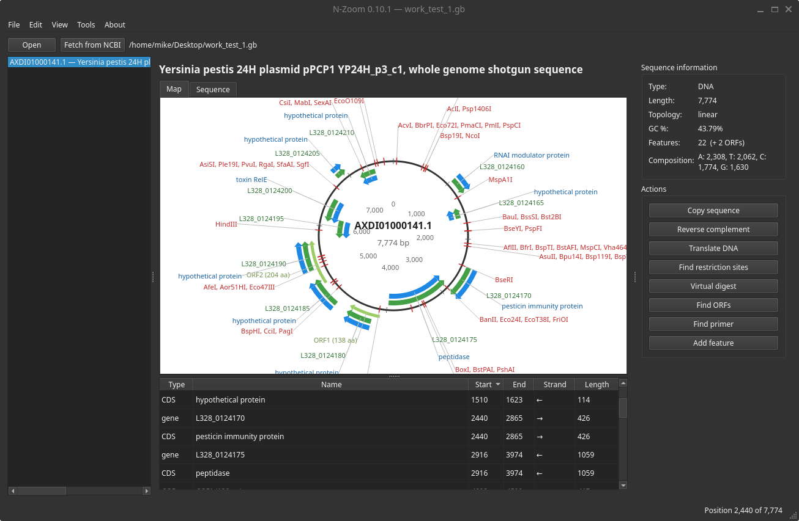
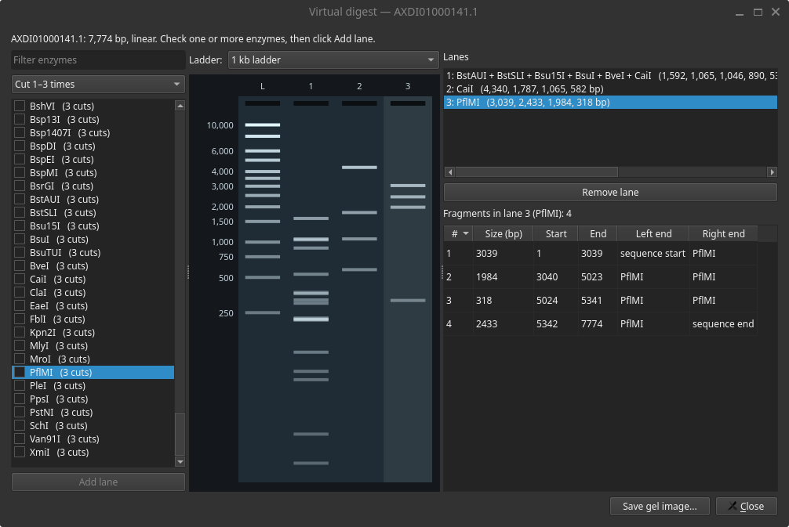

# N-Zoom

**An open-source DNA and protein sequence viewer, written in Python.**

N-Zoom is a lightweight, free alternative to commercial plasmid tools. Open a FASTA or GenBank file, or pull a sequence straight from NCBI. You can then explore it on an annotated circular map.

[](#)


> [!IMPORTANT]
> Early alpha (v0.13.1). A first stable release is planned for 2027.




---

## Features

 **Open FASTA and GenBank files**, including files that hold several records
- **Circular and linear maps** with colored, strand-aware features and auto-placed labels; the style follows the sequence's topology, or pick one yourself
- **Zoomable maps**: mouse-wheel zoom on both the circular and linear map, down to individual bases
- **Export maps** as high-resolution PNG or editable SVG
- **Feature table** that is sortable and linked to both the map and the sequence view
- **Add, edit and delete features**, including features that cross the origin of a circular plasmid, with full **undo/redo**
- **Find sequence** (Ctrl+F) with IUPAC codes, on both strands, with every match highlighted
- **ORF finder** that searches all six reading frames; turn any ORF into a CDS feature with one click
- **Right-click menus** to copy, reverse-complement or translate any selection or feature
- **Colored sequence view** for DNA and protein, with a live position, length and GC% readout for the selection
- **Restriction site analysis** over all commercially available enzymes, with unique cutters marked on the map
- **Virtual digest** with single and multiple enzymes, a simulated agarose gel with ladders, fragment tables, and PNG export
- **Primer search**: paste a primer to see where its 3′ end binds on either strand, with Tm, and add it to the map
- **Sanger read alignment**: align `.ab1`, FASTQ or FASTA reads to your plasmid, with quality trimming, a list of mismatches and indels, and the chromatogram at each difference
- **Fetch sequences from NCBI** by accession number
- **Translation** that respects strand, `/codon_start` and `/transl_table`, plus reverse complement, GC content and composition stats
- **Save as GenBank or FASTA**, with a warning before you lose unsaved changes
- **Light and dark mode**, following your system setting or chosen by hand


## Requirements

- Python 3.10 or newer, with pip
- [PySide6](https://pypi.org/project/PySide6/) 6.7 or newer
- [Biopython](https://biopython.org/) 1.83 or newer

## Installation

Clone the repository, then install the dependencies:

```bash
git clone <repository-url>
cd N-Zoom
pip install -r requirements.txt
```

Using a virtual environment is recommended:

```bash
python -m venv .venv
source .venv/bin/activate        # Windows: .venv\Scripts\activate
pip install -r requirements.txt
```

## Quick start

```bash
python main.py
```

Then try one of these:

- **File → Open…** and pick any `.gb` or `.fasta` file.
- Open `examples/pDEMO.gb`, then try **Virtual digest** with EcoRI + HindIII, **Find ORFs**, and right-click any feature.
- With pDEMO open, click **Align reads** and pick the three `examples/pDEMO_*.ab1` files: they reveal a point mutation at position 1,000.
- Switch between light and dark mode in **View → Theme**.
- Click **Fetch from NCBI** and enter `L09137` to load the real pUC19 plasmid.

## Documentation

The full user manual is in **[docs/documentation.md](docs/documentation.md)**. It covers every view and tool, color legends, file format notes, known limitations and troubleshooting.

## Running the tests

```bash
pip install -r requirements-dev.txt
pytest
```

The tests run without opening any windows and never connect to NCBI. Run them before every commit.

## Project structure

```
N-Zoom/
├── main.py              # main window: start the app here
├── requirements.txt
├── requirements-dev.txt # extra tools for development (pytest)
├── pytest.ini           # pytest settings
├── core/
│   ├── __init__.py
│   ├── dialogs.py       # pop-up windows: feature editor, translation, restriction sites
│   ├── digest.py        # virtual digest window and simulated gel
│   ├── maps.py          # circular and linear maps, image export
│   ├── primers.py       # primer search window
│   ├── reads.py         # sequencing-reads window and chromatogram
│   ├── seqtools.py      # sequence logic: files, features, ORFs, primers, digests, reads, NCBI
│   ├── theme.py         # light and dark colors
│   ├── undo.py          # undoable feature changes
│   ├── viewers.py       # sequence view
│   └── workers.py       # runs slow tasks in the background
├── docs/
│   └── documentation.md # user manual
├── examples/
│   ├── pDEMO.gb         # demo plasmid with features
│   └── pDEMO_*.ab1      # simulated Sanger reads of a pDEMO clone
├── tools/
│   ├── abif_writer.py   # writes simulated .ab1 files (for demos and tests)
│   └── make_demo_reads.py
└── tests/
    ├── conftest.py      # shared test setup
    ├── test_seqtools.py # sequence logic
    ├── test_orfs.py     # ORF finder
    ├── test_primers_digest.py  # primers, Tm, digests and Find
    ├── test_reads.py    # read loading, trimming and alignment
    ├── test_environment.py     # checks the installed libraries
    └── test_gui.py      # main-window workflows
```

## Contributing

Bug reports and suggestions are welcome; please open an issue. N-Zoom is in early development, so expect things to change.

---

Created by **mikeph52** _2026 GNU Public License v3_.