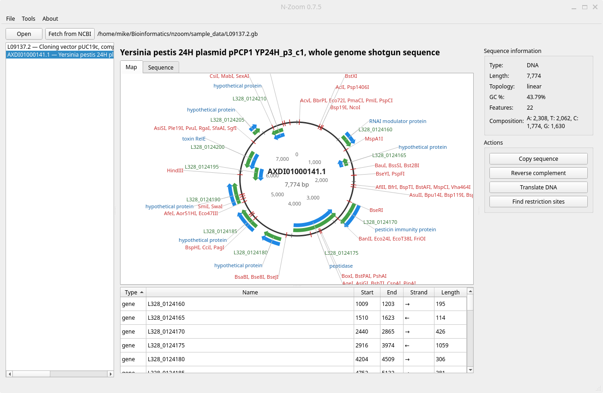

# N-Zoom

**An open-source DNA and protein sequence viewer, written in Python.**

N-Zoom is a lightweight, free alternative to commercial plasmid tools. Open a FASTA or GenBank file, or pull a sequence straight from NCBI. You can then explore it on an annotated circular map.

> [!IMPORTANT]
> Early alpha (v0.10.1). A first stable release is planned for 2027.



---

## Features

- **Open FASTA and GenBank files**, including files that hold several records
- **Circular and linear maps** with colored, strand-aware features and auto-placed labels; the style follows the sequence's topology, or pick one yourself
- **Feature table** that is sortable and linked to both the map and the sequence view
- **Add, edit and delete features**, including features that cross the origin of a circular plasmid
- **ORF finder** that searches all six reading frames; turn any ORF into a CDS feature with one click
- **Right-click menus** to copy, reverse-complement or translate any selection or feature
- **Colored sequence view** for DNA and protein, with a live position, length and GC% readout for the selection
- **Restriction site analysis** over all commercially available enzymes, with unique cutters marked on the map
- **Virtual digest** with single and multiple enzymes, a simulated agarose gel with ladders, fragment tables, and PNG export
- **Primer search**: paste a primer to see where its 3′ end binds on either strand, with Tm, and add it to the map
- **Fetch sequences from NCBI** by accession number
- **Translation** that respects strand, `/codon_start` and `/transl_table`, plus reverse complement, GC content and composition stats
- **Save as GenBank or FASTA**, with a warning before you lose unsaved changes
- **Light and dark mode**, following your system setting or chosen by hand

## Requirements

- Python 3.10 or newer, with pip
- [PySide6](https://pypi.org/project/PySide6/) 6.7 or newer
- [Biopython](https://biopython.org/) 1.83 or newer

## Installation

Clone the repository, then install the dependencies:

```bash
git clone <repository-url>
cd N-Zoom
pip install -r requirements.txt
```

Using a virtual environment is recommended:

```bash
python -m venv .venv
source .venv/bin/activate        # Windows: .venv\Scripts\activate
pip install -r requirements.txt
```

## Quick start

```bash
python main.py
```

Then try one of these:

- **File → Open…** and pick any `.gb` or `.fasta` file.
- Open `examples/pDEMO.gb`, then try **Find restriction sites** and **Find ORFs**, and right-click any feature.
- Click **Fetch from NCBI** and enter `L09137` to load the real pUC19 plasmid.

## Documentation

The full user manual is in **[here](docs/documentation.md)**. It covers every view and tool, color legends, file format notes, known limitations and troubleshooting.

## Project structure

```
N-Zoom/
├── core
│   ├── __init__.py
│   ├── __pycache__
│   │   ├── __init__.cpython-314.pyc
│   │   ├── seqtools.cpython-314.pyc
│   │   └── viewers.cpython-314.pyc
│   ├── seqtools.py
│   └── viewers.py
├── docs
│   └── documentation.md
├── main.py
├── README.md
├── requirements.txt
└── sample_data
    ├── L09137.2.gb
    ├── protein.faa
    ├── rna.fna
    └── ti_plasmid.fasta
```
## Contributing

Bug reports and suggestions are welcome; please open an issue. N-Zoom is in early development, so expect things to change.

---

Created by **mikeph52** _2026 GNU Public License v3_.